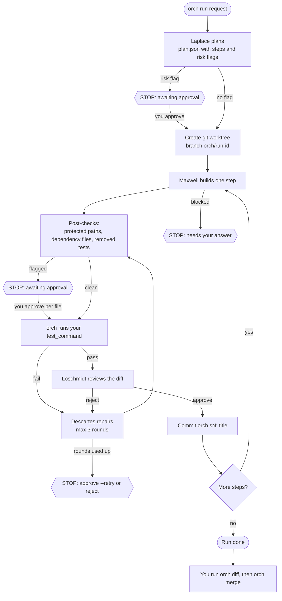

<div align="center">

# Firmamentum

**A multi-agent orchestrator that runs Claude Code and Antigravity CLI on your own subscriptions.**


</div>

## Why

Your Claude Pro and Google AI Pro plans already include two strong coding agents, but each one works alone and by hand. Firmamentum (the `orch` command) drives the two official CLIs for you: it plans a task, builds it step by step in a git worktree, runs your tests itself, has a second model review the diff, and stops for you before anything sensitive. It never reads a login token and it never pushes.

<!--
Demo GIF placeholder (the file is not in the repo yet).
To record it:
  1. Open Windows Terminal and run:  uv run python scripts/make_practice_repo.py
  2. Start a recorder such as ScreenToGif (Windows) at about 100 columns wide.
  3. Run:  uv run orch run "Make slugify in src/practice/text.py strip accents" --repo practice
  4. Stop at the "Result: done" line and keep the GIF under 10 MB.
  5. Save it as docs/assets/demo.gif, then remove this comment.
-->


## Contents

- [Meet the demons](#meet-the-demons)
- [How it works](#how-it-works)
- [Quickstart](#quickstart)
- [Setup on Windows](#setup-on-windows)
- [Commands](#commands)
- [Screens, theme and doctor](#screens-theme-and-doctor)
- [Configuration](#configuration)
- [Safety model](#safety-model)
- [Cost](#cost)
- [Roadmap](#roadmap)

## Meet the demons

Five roles do the work. Each one is named after a thought experiment, and each reads its agent and model from `config.yaml`.

| Demon | Role | Default models | Tools | Why the name fits |
|---|---|---|---|---|
| **Laplace** | Planner | `claude:opus`, then `claude:sonnet` | Read, Grep, Glob only | Laplace's demon predicts the whole future from the present. This one predicts the steps before any code is written. |
| **Brillouin** | Scout (optional, `--scout`) | `agy:default` | Read only (`agy --mode plan`) | Brillouin's demon must observe before it can act. This one reads the repo first and summarizes it for Laplace. |
| **Maxwell** | Builder | `claude:sonnet` | Read, Grep, Glob, Edit, Write, and Bash limited to the test commands | Maxwell's demon sorts molecules one at a time. This one sorts out exactly one step of the plan and builds it. |
| **Loschmidt** | Reviewer | `claude:opus`, `claude:sonnet`, `agy:default` | Read, Grep, Glob only (agy: `--mode plan`) | Loschmidt ran the physics backwards to test it. This one reads the finished diff backwards against the step and its acceptance. |
| **Descartes** | Repair | `claude:sonnet` | Same as Maxwell, plus the quick `retest_command` | Descartes doubts everything until the evidence agrees. This one distrusts the failing test, finds the real cause, and makes the smallest fix. |

Maxwell and Descartes are Claude only, because `agy` has no tool allow-list. The role instructions live in `src/orch/roles/` (the scout prompt is built into `planner.py`).

## How it works



Steps marked STOP pause the run and print the exact next command. Everything else runs on its own. If an agent hits a usage limit, the router moves to the next entry for that role once. If nothing is left, the run pauses and `orch resume` continues it later.

## Quickstart

```powershell
git clone -b v2 https://github.com/Aidilzin/Firmamentum.git; cd Firmamentum
uv sync
uv run orch version
uv run python scripts/make_practice_repo.py
uv run orch run "Make slugify in src/practice/text.py strip accents" --repo practice
```

Run them one at a time. Read the next section first if `claude` or `agy` is not logged in yet. The last command uses real quota, roughly 250k tokens (see [Cost](#cost)). When it finishes, review the result with `uv run orch diff <run-id> --repo practice`.

## Setup on Windows

Requirements: Windows 11 (tested), Python 3.12, [uv](https://docs.astral.sh/uv/), git, the Claude Code CLI logged in with a **Claude Pro** account, and the Antigravity CLI (`agy`) logged in with a **Google AI Pro** account.

1. Install both CLIs and check that a fresh terminal finds them: `claude --version`, then `orch version` (it also prints the `agy` version).
2. Log in once by hand. Run `claude` and choose the subscription login. Run `agy` and sign in with the Google account that has AI Pro.
3. In this repo run `uv sync`, then `uv run pytest -q`. The tests use a fake adapter and never call a real CLI.

<details>
<summary><strong>Windows pitfalls (read this if a call bills the wrong account or does nothing)</strong></summary>

- **Log in with the Pro plan, not the Console.** When `claude` asks how to log in, choose the Claude account with a subscription (Pro or Max). The Anthropic Console option bills API credits.
- **Check `~/.claude/settings.json`** (`%USERPROFILE%\.claude\settings.json`). If it has an `env` block with `ANTHROPIC_BASE_URL`, `ANTHROPIC_AUTH_TOKEN`, `ANTHROPIC_API_KEY`, or Ollama or proxy settings, `claude -p` talks to that endpoint instead of your Pro plan. Remove those entries or keep them out of the profile you use here. `orch` strips `ANTHROPIC_API_KEY`, `ANTHROPIC_AUTH_TOKEN` and `ANTHROPIC_BASE_URL` from the child process environment, but it cannot undo what the settings file sets.
- **Unset `ANTHROPIC_API_KEY`.** Check that `$env:ANTHROPIC_API_KEY` is empty in PowerShell and remove it from your user environment variables if it is set. With it set, Claude Code bills the API key instead of the Pro plan.
- **Fix PATH.** If `claude` or `agy` is not found in a new terminal, add their install folders to your user `PATH` and reopen the terminal.
- **Run one PowerShell command at a time.** Paste commands separately, not as a block, so you can see which one fails.
- **Do not set `VIRTUAL_ENV` by hand.** `orch` removes it from every child process (uv prints a noisy warning otherwise).

</details>

## Commands

Every command that takes a run id also accepts a unique prefix of it and `--repo <name-or-path>` (default: the current directory). Examples use a short prefix.

| Command | What it does | Example |
|---|---|---|
| `ask` | Sends one prompt to one CLI and logs the usage | `orch ask --agent claude --model sonnet --prompt "Reply PONG"` |
| `usage` | Calls, tokens and failures per agent and model (`--days`, `--window 5h`, `--json`) | `orch usage --window 24h` |
| `cooldowns` | Lists active rate-limit cooldowns, or clears them with `--clear [claude\|agy]` | `orch cooldowns --clear claude` |
| `doctor` | Checks the setup: tools, logins, leftover env vars, config, repos, paths (`--live` makes one tiny call per CLI) | `orch doctor` |
| `version` | Prints the orch, claude and agy versions (costs no quota) | `orch version` |
| `plan` | Asks Laplace for a plan and stores it (`--scout` adds Brillouin) | `orch plan "add a --json flag to usage" --repo orch` |
| `runs` | Lists stored runs, newest first | `orch runs --repo orch` |
| `show` | Prints a stored plan | `orch show 20261110T --repo orch` |
| `exec` | Executes a stored plan in a new worktree, no merge | `orch exec 20261110T --repo orch` |
| `run` | Plans, then executes, in one go | `orch run "add password reset" --repo orch` |
| `resume` | Continues after a pause or crash (`--force` ignores `resume_after`) | `orch resume 20261110T --repo orch` |
| `status` | Steps, tests, rounds, verdicts, tokens by role, and what you need to do | `orch status 20261110T --repo orch` |
| `approve` | Approves a stopped step and continues (`--step`, and `--retry` after repairs ran out) | `orch approve 20261110T --step s1 --repo orch` |
| `reject` | Rejects a step and stops the run | `orch reject 20261110T --step s1 --repo orch` |
| `answer` | Answers a planner or builder question | `orch answer 20261110T "use sqlite" --step s1 --repo orch` |
| `diff` | Shows a run's diff (`--step sN`). Stopped steps show their uncommitted changes | `orch diff 20261110T --step s1 --repo orch` |
| `merge` | `--no-ff` merge into your current branch, then runs the tests (`--allow-main`) | `orch merge 20261110T --repo orch` |
| `clean` | Removes the worktree and keeps the branch | `orch clean 20261110T --repo orch` |

Exit codes of `exec`, `run`, `resume`, `approve` and `answer`: 0 done, 1 failed, 2 needs input, needs approval or refused, 3 paused.

**Live view.** `exec`, `run`, `resume`, `approve` and `answer` draw the constellation and one line per demon (see [Screens, theme and doctor](#screens-theme-and-doctor)), with the model used (marked `(fallback)` when it is not the first choice), plus a footer with total tokens and run status. When a run stops, a panel says what happened, why, and the exact next command. Use `--plain`, or pipe the output, for line-by-line text with a `--- STOPPED ---` block instead.

**Practice mode.** `orch run` and `orch exec` accept `--hidden-tests DIR`. It copies the files of `DIR` into the worktree's `tests/` after Maxwell finishes the first step and before the checks, so Maxwell never saw them and a real repair round happens. Use it for practice repos only. `DIR` must be outside the repo and outside any worktree, and its file names must not already exist in `tests/`. Create the practice repo with `uv run python scripts/make_practice_repo.py`. It makes `C:\projects\orch-practice` and the uncommitted sibling `C:\projects\orch-practice-hidden`. The request used for the practice checks is narrow on purpose, so the builder does not cover the hidden tests (repeated separators, trimming `-`) on the first try:

```powershell
uv run orch run "Make slugify in src/practice/text.py strip accents, for example 'Café' becomes 'cafe'" --repo practice --hidden-tests ../orch-practice-hidden
```

The reviewer and the repair agent are told the copied files were added on purpose. Repair must not delete or edit them.

## Screens, theme and doctor

**Home.** `orch` with no arguments prints the wordmark once, then your repos, the model each demon tries first, tokens used in the last 5h and 24h, active cooldowns, the latest run and a few example commands. `orch --help` is the normal help.

**Constellation.** Steps are drawn as stars, with one line for each demon that has run or is running:

```
✦───✦───✧───·  step 3 of 4 · Add tests
✦ Laplace     planned 4 steps            opus · 44k
◆ Maxwell     building s3                sonnet · 0:41
```

`✦` done, `✧` running (in the colour of the demon working), `·` pending, `✗` failed, `!` needs you. Every state also has a glyph and a word, never colour alone. `orch status` shows the same header above its step table, with a `time` column filled from the `started_at` / `ended_at` stamps the executor now writes to `meta.json` (older runs show `-`).

| Demon | Role | Glyph | ASCII | Dark | Light |
|---|---|---|---|---|---|
| Laplace | planner | ✦ | `*` | `#7AA2F7` | `#2E5EAA` |
| Brillouin | scout | ◎ | `o` | `#7DCFFF` | `#0E7C86` |
| Maxwell | builder | ◆ | `#` | `#FF9E64` | `#B85C00` |
| Loschmidt | reviewer | ↺ | `<` | `#BB9AF7` | `#7A4FC2` |
| Descartes | repair | ✚ | `+` | `#F38BA8` | `#B4235A` |

**Theme.** Dark is the default. Choose with, in this order: `--theme dark|light` (before the subcommand: `orch --theme light status ...`), the `ORCH_THEME` environment variable, or `ui: { theme: light }` in `config.yaml`. No background colour is ever set. `NO_COLOR` turns colour off and keeps the glyphs. `--ascii`, or a terminal that cannot encode the glyphs, switches to `* o # < +` and `[ok] [!] [x]`.

**`orch doctor`.** Prints `✓` / `!` / `✗` per check with a one-line fix, never a secret value, and exits 1 if any check is `✗`. It checks Python, `uv`, `git`, `claude` and `agy` (found, `--version`, on PATH), `ANTHROPIC_API_KEY` / `AUTH_TOKEN` / `BASE_URL` in the process and the Windows user environment, `~/.claude/settings.json` (an `ANTHROPIC_*` `env` block, or a local `model` such as `qwen3:8b`, which points Claude Code away from your Pro login), the Claude login type (via `claude auth status`, which makes no model call; `agy` has no such command, so doctor tells you to check it by hand), `config.yaml`, each repo (path, git, `test_command`), that the worktree root and usage DB are writable, `tzdata`, and active cooldowns. `agy` missing is `!`, and `✗` only when some role lists agy entries only. `orch doctor --live` asks for confirmation, then sends one "Reply PONG" to each CLI (cheapest model) to prove the logins work; it costs plan quota, so it is off by default.

## Configuration

Everything is in `config.yaml`. `--model role=model` on any command puts that model first for the role, for example `--model builder=opus`. `ORCH_CONFIG` overrides the config path.

```yaml
roles:                                  # ordered fallback lists of agent:model
  planner:  [claude:opus, claude:sonnet]                # Laplace
  scout:    [agy:default]                               # Brillouin; agy:default = agy with no --model
  builder:  [claude:sonnet]                             # Maxwell; builder and repair: claude only
  reviewer: [claude:opus, claude:sonnet, agy:default]   # Loschmidt
  repair:   [claude:sonnet]                             # Descartes
cooldown_minutes: 60                    # used when a limit message has no parsable reset time
approval_rules:                         # the stops listed under "Safety model"
  - merge_to_main
  - delete_outside_worktree
  - touches_auth_payments_secrets_env
  - db_migration_or_schema
  - new_dependency
  - tests_fail_after_3_repairs
  - tests_removed
  - plan_needs_input
  - all_agents_rate_limited
review: per_step                        # per_step | off
max_repair_rounds: 3
ui: { theme: dark }                     # dark | light (optional)
repos:                                  # the ONLY source of test commands
  orch:     { path: ".", test_command: "uv run pytest -q", retest_command: "uv run pytest -q --lf" }
  practice: { path: "../orch-practice", test_command: "uv run pytest -q", retest_command: "uv run pytest -q --lf" }
```

- `test_command` gates every commit. `retest_command` is optional and is a quick re-run tried first in repair rounds.
- Relative repo paths resolve against the folder that holds `config.yaml`.
- If the first entry of a role hits a limit, the next entry is tried once. The entry used is shown in the live view and in `orch status`.

## Safety model

| Guard or stop | What it does |
|---|---|
| Worktrees only | Agents edit a git worktree under `%LOCALAPPDATA%\orch\wt\<repo>\<run>` on branch `orch/<run>`, outside your checkout. Your main checkout stays clean. |
| Path guards | `reset --hard`, `clean` and `worktree remove` refuse any path that is not a linked worktree under that root. |
| Read-only roles | Laplace and Loschmidt run claude with `--tools Read,Grep,Glob` and no prompts. Brillouin and agy run `--mode plan`. |
| Limited builder | Maxwell and Descartes get Edit and Write, and Bash only for the configured test commands. `git`, `uv add`, `pip`, `rm` and `del` are denied. The `rm` denial was confirmed in a real run. |
| Test command from config only | The plan's `test_command` is never used. `orch` runs the tests itself and trusts the exit code, not an agent's claim. |
| Approval stop: protected paths | Touching auth, payment or secret paths, `.env` files or keys stops the step (`touches_auth_payments_secrets_env`). |
| Approval stop: dependencies | Changing `pyproject.toml` or `uv.lock` stops the step (`new_dependency`). |
| Approval stop: removed tests | Deleting a test file or a test function stops the step (`tests_removed`). |
| Approval stop: repairs used up | Tests still failing after 3 repair rounds stop the step. Plain approve is refused. Use `approve --retry` or `reject`. |
| Approval stop: questions | A planner or builder question (`needs_input`) waits for `orch answer`. |
| Approval stop: no agent left | Both agents rate limited pauses the run. |
| Approvals are per file | Approving covers only the flagged files and rules. A new flagged item stops again. |
| Nothing failing is committed | Failing tests are never committed. With review on, nothing is committed unreviewed. |
| Never pushes | `merge` is local only. It refuses on a dirty tree, a detached HEAD, or main or master without `--allow-main`. |
| Credentials | `orch` never reads OAuth tokens or credential files. The child environment for `claude` has the `ANTHROPIC_*` variables removed. |

## Cost

Each real call carries a large fixed system prompt, so even a tiny prompt costs about 13k to 24k tokens of plan quota. These numbers come from the real runs in `docs/`. Tokens include cache reads and writes.

| Call | Demon | Model | Tokens |
|---|---|---|---|
| `ask` "Reply PONG" | none | claude sonnet | 23,757 |
| `ask` "Reply PONG" | none | agy default | 13,268 |
| Plan (reads the repo) | Laplace | claude opus | 44,761 to 87,485 |
| Build, one step | Maxwell | claude sonnet | 74,019 to 120,257 |
| Review, one diff | Loschmidt | claude opus | 26,703 to 86,257 |
| Repair round (resumed session) | Descartes | claude sonnet | 71,413 to 129,722 |
| Scout | Brillouin | agy default | not measured in a real run |

Whole runs: a one-step run with review and no repair used 145,656 tokens (delete a function and its tests) or 284,515 tokens (add a flag). A one-step run with one repair round used 246,833 tokens. Use `orch usage` for your own totals, and keep experiments tiny.

## Roadmap

Phases 0 to 5 are done: spike, adapters, planner, isolated execution, review and repair, router with cooldowns, live view and docs. The full plan, the decisions that changed along the way, and the list of next ideas are in [docs/PLAN.md](docs/PLAN.md). Phase notes with real-run results and untested items are in `docs/phase0-findings.md` to `docs/phase5b-notes.md`.

- **Next: Phase 6, UI and UX.**
- Later ideas: capture real rate-limit messages, an MCP server, parallel independent steps, cleaning old worktrees, and a second target repo.

---

<div align="center">

Firmamentum v1 is kept as the git tag `v1-qwen-runpod`. Built with [Claude Code](https://claude.com/claude-code).

</div>
