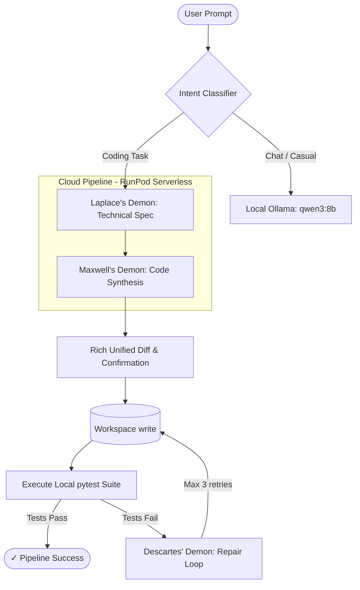

# Firmamentum 🏛️

> **Hybrid Local/Cloud Multi-Agent Orchestrator for Autonomous Software Development**

Firmamentum is an interactive, intent-routing CLI orchestrator that pairs a small local LLM (served via Ollama) with a high-capacity cloud model (served via RunPod Serverless GPU) to delegate software development workflows to a team of specialized AI agents ("Demons").

---

## 🚀 Key Features

* 🔀 **Intent-Aware Hybrid Routing**: Casual chat queries and lightweight questions are handled locally via Ollama (`qwen3:8b`) at zero cost. Complex code modifications automatically trigger the cloud agent pipeline on RunPod (`qwen3.6-27b-fp8`).
* 👹 **Three-Demon Persona Pipeline**:
  1. **Laplace's Demon (Spec & Architecture)**: Maps codebase dependencies and generates clean technical specifications.
  2. **Maxwell's Demon (Surgical Code Build)**: Synthesizes precise, fence-wrapped production code without conversational noise.
  3. **Descartes' Demon (Root-Cause QA & Repair)**: Runs local `pytest` test suites and iteratively fixes failed assertions using terminal traceback logs.
* 🔁 **Closed-Loop Verification & Repair**: Programmatically executes unit tests via subprocess and loops up to 3 repair passes until all assertions pass.
* 🛡️ **Supply-Chain Guarded Skill Discovery**: Dynamically searches, scores, and ingests modular skill sheets (e.g. Anthropic's official skill library) using fuzzy keyword matching and strict trusted-repository allowlists.
* 🎨 **Interactive Terminal Interface**: Built with `rich` featuring syntax-highlighted diff previews, live polling spinners, and color-coded persona announcements.

---

## 🏛️ The Three Demon Personas

Firmamentum structures complex coding tasks across three specialized system personas defined in [`daemon_skills/`](./daemon_skills):

| Demon | Domain | Core Role | Output |
| :--- | :--- | :--- | :--- |
| **Laplace** | Repository Layout | **Structural Dependency Mapper** | Markdown Technical Spec (Files to modify, architectural hazards) |
| **Maxwell** | Source Code | **Surgical Code Injector** | Clean, targeted python source code blocks |
| **Descartes** | Terminal Tracebacks | **Root-Cause Analysis & Repair** | Bug fixes driven by failing `pytest` logs |

---

## ⚙️ Architecture Workflow



---

## 📦 Getting Started

### Prerequisites

1. **Python 3.10+** installed.
2. **[Ollama](https://ollama.ai/)** running locally with your desired local chat model:
   ```bash
   ollama pull qwen3:8b
   ```
3. **RunPod Serverless GPU** endpoint running a coding LLM (e.g. `qwen/qwen3.6-27b-fp8`).

### Installation

1. **Clone the repository**:
   ```bash
   git clone https://github.com/YourUsername/Firmamentum.git
   cd Firmamentum
   ```

2. **Create and activate a virtual environment**:
   ```bash
   python -m venv venv
   # On Windows (PowerShell):
   .\venv\Scripts\Activate.ps1
   # On Linux/macOS:
   source venv/bin/activate
   ```

3. **Install dependencies**:
   ```bash
   pip install -r requirements.txt
   ```

4. **Configure Environment Variables**:
   Copy `.env.example` to `.env` and fill in your keys:
   ```bash
   cp .env.example .env
   ```
   Edit `.env`:
   ```ini
   RUNPOD_ENDPOINT_ID=your_runpod_endpoint_id
   RUNPOD_API_KEY=your_runpod_api_key
   OLLAMA_MODEL=qwen3:8b
   ```

---

## 💡 Usage

### Interactive REPL Mode

Launch the interactive prompt session:
```bash
python proxy.py
```

#### REPL Command Reference

* `/ask <question>` — Force local chat mode (Ollama, no files touched).
* `/build <task>` — Force cloud coding task mode (PM → Dev → QA pipeline).
* `/file <filename>` — Set target workspace file (default: `app.py`).
* `/auto` — Toggle auto-accept write confirmation (on/off).
* `/status` — View target file, workspace state, and last pipeline result.
* `/history` — List completed tasks for the current session.
* `/skills list` — List cached local skill sheets.
* `/skills search <keyword>` — Search trusted GitHub repositories for matching skill sheets.
* `/skills add <owner/repo>` — Trust a new GitHub repository (requires typed confirmation).
* `/skills sync` — Re-fetch cached skills from trusted source repositories.
* `/exit` or `/quit` — Exit the REPL.

### One-Shot CLI Mode

Execute a single task directly from your command line:
```bash
python proxy.py "Build a REST API endpoint for user authentication" --file auth.py --yes
```

---

## 🔒 Security & Supply-Chain Guards

To prevent prompt injection and untrusted instruction leaks during agent skill discovery:
* **Allowlist Enforcement**: Skill searches are restricted to explicitly trusted repositories listed in [`skill_manager.py`](./skill_manager.py) (default: `anthropics/skills`).
* **Explicit Confirmation**: Trusting a new repository via `/skills add` requires manual CLI confirmation and double-entry typing.
* **Local Isolation**: All code modifications are strictly scoped to the `./workspace` directory.

---

## 📁 Repository Structure

```
Firmamentum/
├── proxy.py              # Main CLI orchestrator & agent pipeline executor
├── skill_manager.py      # Skill discovery, caching, & security allowlist manager
├── requirements.txt      # Python dependencies
├── .env.example          # Environment variable template
├── daemon_skills/        # System prompt personas
│   ├── laplace_spec.md       # Laplace's Demon prompt
│   ├── maxwell_build.md      # Maxwell's Demon prompt
│   └── descartes_repair.md   # Descartes' Demon prompt
└── workspace/            # Target directory for generated code & tests
```

---

## 📜 License

Distributed under the [MIT License](./LICENSE).
